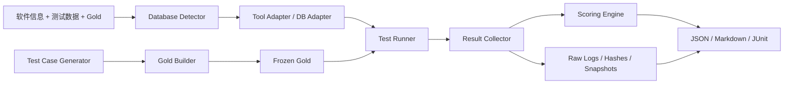

# 总体架构

## 设计边界

框架评价的是数据库软件质量，而不是“重构实现是否复制了原软件的物理 Schema”。数据逻辑等价可以接受，但必须由该软件的需求、接口契约、行为规范和 Gold 独立证明。

框架不试图寻找一个“自动测试所有数据库”的工具。它将工作分成：

1. 可以直接执行的成熟工具。
2. 需要测试配置或 Gold 输入的成熟工具。
3. 只能提供底层能力、还需要编排器开发的工具。
4. 必须针对软件业务语义生成的测试。

## 模块与数据流



### Database Detector

识别后端、版本、数据库文件或连接方式，并收集能力和版本证据。SQLite 通过文件头、`sqlite3` 模块版本和 `PRAGMA` 识别；DSN 探测在其他 Adapter 中实现。探测失败是环境错误，不得自动判为零分。

### Tool Adapter

统一数据库连接、Schema 读取、备份恢复、健康检查和外部测试工具调用。外部工具至少支持三种归一化结果：

- 进程退出码。
- JUnit XML。
- 带 `findings` 和 `measurements` 的 JSON。

原始 stdout/stderr 保留在 case 目录，结构化摘要进入总报告。密码和凭据不得进入命令行证据。

### Test Case Generator

分级生成：

1. Schema 与约束事实。
2. 通用完整性和健康规则。
3. 显式实体契约驱动的 CRUD 状态序列。
4. API/ORM Adapter 驱动的业务序列。
5. LLM 候选程序与人工复核。

自动生成物只能成为 `candidate`；通过独立验证后才能进入 `verified` 和 `frozen`。

### Gold Builder

负责合并候选用例、补全来源、验证断言和冻结。一个 Gold bundle 绑定：

- 软件名、版本和可选制品哈希。
- 证据文件哈希。
- 初始数据库与用例操作。
- 显式预期和断言。
- 环境与适用性条件。
- Gold 内容哈希和可选 HMAC 签名。

### Test Runner

每个 case 默认从不可变初始化模板创建独立环境。记录 setup、操作、断言、耗时和失败类别。连续 benchmark 和并发测试使用相同 Adapter 能力声明，但评分方式不同。

### Result Collector

除通过/失败外，还收集：

- 测量值、单位、样本量。
- 安全发现和严重级别。
- 规范化前后状态。
- 工具版本、数据库版本和环境指纹。
- 输入文件与证据文件哈希。

### Scoring Engine

只消费经验证的 Gold 归属和规范化结果。覆盖率、质量分、执行完整度和 Gold 变异得分分开。

### Report Generator

同一份评分对象输出 JSON、Markdown 和 JUnit。JSON 是权威机器结果；Markdown 不得引入 JSON 中没有的证据；JUnit 中产品断言失败、执行错误和跳过分别映射为 failure、error、skipped。

## 关键数据对象

`Project` 描述被测软件、数据库、隔离方式、适用功能和维度权重。`GoldBundle` 描述软件专属正确性。`CaseResult` 是执行层与评分层之间唯一的稳定契约：

```text
case_id, dimension, indicator, status,
point_score, weight, applicable,
checks[], measurements[], findings[],
evidence{}, error_kind, duration_ms
```

`status` 分类：

| 状态 | 含义 | 是否进入质量分母 |
| --- | --- | --- |
| `passed` | Gold 断言全部满足 | 是 |
| `failed` | Gold 明确失败 | 是 |
| `not_applicable` | 显式适用性条件不满足 | 否 |
| `skipped` | 主动跳过，保留原因 | 否 |
| `environment_error` | setup、隔离或环境无法建立 | 否，进入完整性 |
| `tool_error` | 工具缺失、超时或输出契约错误 | 否，进入完整性 |
| `framework_error` | 框架自身异常 | 否，进入完整性 |

## 隔离模型

SQLite 参考实现对每个 case：

1. 在运行目录只用 Schema 和 Seed 构建一次模板。
2. 通过 SQLite backup API 克隆模板。
3. 启用外键、busy timeout 和 WAL。
4. 在独立副本执行 setup、操作和断言。
5. 保留数据库副本与结果证据。

其他数据库推荐使用 Testcontainers 或一次性数据库/用户。禁止在正式生产库运行性能、故障或安全主动测试。

## 新增数据库适配器

实现 `src/dbeval/adapters/base.py` 中的两个接口：

- `DatabaseAdapter`：探测、准备、打开会话、Schema 检查、工具版本。
- `DatabaseSession`：执行、查询、benchmark、备份恢复、备份查询和健康探测。

第三方模块可以通过 `dbeval.adapters.register_adapter(backend, factory)` 注册，也可以
在项目 `database.adapter_plugin` 中指定一个 Python 模块。插件模块必须导出
`register(registry)`，并调用 `registry["register_adapter"]`。Adapter 工厂的返回值必须
实现 `DatabaseAdapter`。

适配器应声明真实能力，例如 SQLite 不宣称具备应用级角色模型；PostgreSQL 适配器可声明 `pg_amcheck`，但连接池或 ORM 仍由应用 Adapter 验证。不要在评分器里写数据库类型分支。

一个后端的退出标准：

- 原始数据库没有写入。
- 错误分类明确。
- 版本与连接信息可追溯。
- 备份恢复能在隔离环境解密或导入。
- 至少一个健康、一个事务、一个并发和一个性能用例通过。

## 关键设计取舍

- **缺失指标不记零**：零表示“已测且完全失败”，缺失表示“未知”。两者在报告中分开。
- **不把覆盖率加入质量总分**：否则只增加简单测试就能提高产品质量分。覆盖率进入独立完整性和 Gold 质量报告。
- **不直接采信当前输出**：生成器可从设计输入推导预期；当前输出只能用于验证 Gold 是否可执行。
- **先复现再评分**：环境不可复现时，性能数字不具备跨软件比较价值。
