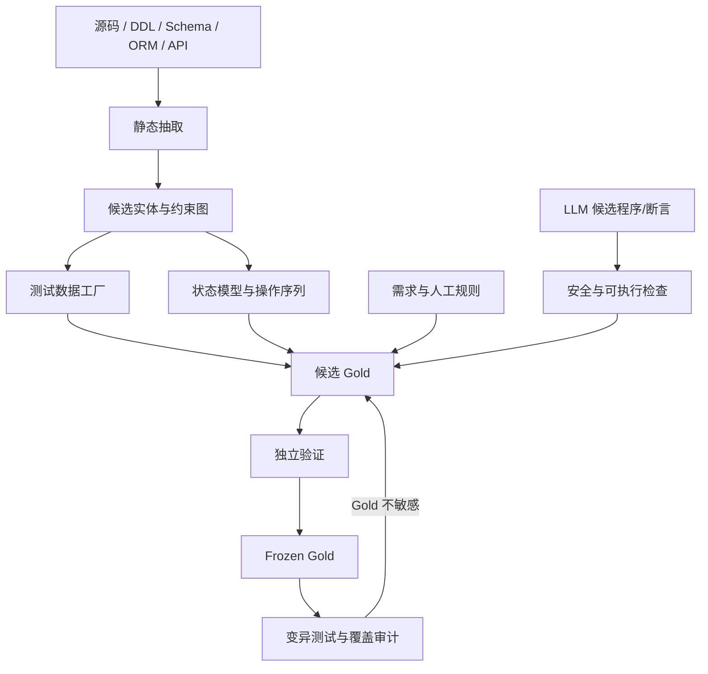

# 测试程序生成与 Gold 设计

## 核心原则

自动生成的目标不是让 AI 同时扮演“出题人、答题人和阅卷人”，而是把可机械推导的部分自动化，并把不可机械推导的业务结论隔离到经过验证的 Gold。

生成过程使用以下优先级：

1. 需求、验收标准、接口规范。
2. DDL、Schema、迁移和约束。
3. ORM Model、数据访问接口和现有测试。
4. 人工确认的领域状态和不变量。
5. 数据库操作轨迹，仅作为辅助证据。
6. LLM 产生的候选测试或候选断言。

当前产品输出永远不能直接成为 Gold 预期。可以用当前输出发现“测试能否执行”，但必须通过另一来源或程序化 oracle 验证答案。

## 自动生成流水线



## 测试数据生成

### 规则优先生成

按 Schema 为每个字段选择边界值：

| 类型/约束 | 候选值 |
| --- | --- |
| 整数 | 0、1、最小值、最大值、边界-1、边界+1 |
| 小数 | 0、正负边界、精度边界 |
| 字符串 | 空串、最小长度、最大长度、Unicode、转义字符 |
| 日期时间 | 起点、格式边界、时区边界 |
| 枚举/CHECK | 每个合法值、非法值 |
| 外键 | 有效父记录、不存在父记录 |
| PK/UNIQUE | 新值、重复值、批量冲突 |
| NULL | 允许时为 NULL，不允许时保留拒绝用例 |

生成器必须遵守外键拓扑，先创建父记录。对复合唯一键生成组合覆盖，而不是只测单列。

### 属性与收缩

Hypothesis 可用于：

- 可逆操作属性，例如编码后解码。
- 不变量，例如库存不得小于零、金额总和等于明细总和。
- 幂等操作，例如重复迁移、重复取消。
- 有状态模型，例如 CRUD 序列后数据库状态与内存模型一致。

失败样例应保存 seed、操作序列和最小化后输入。当前声明式 Runner 可执行结构化 case；需要 Hypothesis 时由 Tool Adapter 包装为规范化 JSON/JUnit。

### 业务数据

从通用 Schema 无法知道“pending 订单能否直接删除”等业务含义。需要领域契约，例如：

```json
{
  "schema_version": "1.0",
  "entities": [
    {
      "name": "product",
      "table": "products",
      "create_values": {
        "id": 990001,
        "sku": "GEN-PRODUCT-1",
        "category_id": 1,
        "name": "Generated Product",
        "price_cents": 1234,
        "stock_units": 7
      },
      "update_column": "stock_units",
      "update_value": 6
    }
  ]
}
```

生成器只根据这个已明确的契约推导操作和预期，不从产品运行结果反推。

## 操作序列生成

### 当前可执行方式

- Schema 生成器：表/列存在、主键唯一、外键检查、完整性、基础读写。
- 实体契约生成器：INSERT → SELECT → UPDATE → SELECT → DELETE → SELECT COUNT。
- 手工 Gold：事务边界、并发不变量、备份恢复、故障和性能。
- 外部命令：Hypothesis、API 扫描器、数据库压测和安全工具。

### 扩展方式

应用 Adapter 应暴露业务操作和数据库状态查询，例如：

```text
create_order(customer, items)
pay_order(order_id)
get_order(order_id)
snapshot_order(order_id)
```

生成器可以组合抽象操作，而不直接依赖 HTTP 细节。预期状态由独立领域模型计算。每个序列保存：

- 前置状态。
- 操作及参数。
- 期望中间状态。
- 期望最终状态。
- 需要回滚或保留的资源。

## 断言和 Oracle

推荐 oracle 顺序：

1. 数学/逻辑可计算断言。
2. 需求给出的精确结果。
3. 数据库约束和关系不变量。
4. Metamorphic relation，例如重复读、插入后删除、换序结果不变。
5. 差分测试，但参考实现本身也必须经过验证。
6. 人工审核的复杂业务预期。

当前 Runner 支持的断言：

| 类型 | 用途 |
| --- | --- |
| `success` / `query_success` | 操作成功 |
| `error_contains` / `any_error` | 非法操作稳定失败 |
| `affected_rows` | DML 返回影响行数 |
| `row_count` | 查询行数 |
| `scalar` | 单个标量值 |
| `rows_equal` | 有序行集合 |
| `rows_equal_unordered` | 无序行集合 |
| `contains_rows` | 至少包含指定行 |
| `json_path` | 外部工具 JSON 字段 |
| `no_findings` | 扫描结果达到严重级别阈值 |
| `health_pass` | 数据库原生健康探测 |

LLM 可以提出断言，但不能跳过程序验证。建议使用 AST 检查、禁止自定义 shell、限定数据和网络、超时和沙箱来审查生成程序。

## Gold 生命周期

```text
draft → candidate → verified → frozen → retired
```

- `draft`：生成但可能不可执行。
- `candidate`：有来源和操作，但 Gold 尚未独立确认。
- `verified`：预期可由独立来源支持，测试已执行验证。
- `frozen`：内容和证据哈希锁定，正式评测可使用。
- `retired`：软件或需求版本变化后保留历史，不再执行。

冻结不会自动把 `candidate` 改成 `verified`。运行器默认拒绝未冻结 Gold。

## 统一 Gold 结构

```json
{
  "schema_version": "1.0",
  "bundle_id": "software-gold-v1",
  "software": {
    "name": "software",
    "version": "1.0.0",
    "artifact_sha256": "optional-artifact-binding"
  },
  "created_at": "2026-11-02T00:00:00Z",
  "created_by": "gold-owner",
  "dimension_weights": {
    "DB1": 1.0,
    "DB2": 1.0,
    "DB3": 1.0,
    "DB4": 1.0,
    "DB5": 1.0,
    "DB6": 1.0,
    "DB7": 1.0,
    "DB8": 1.0
  },
  "cases": [
    {
      "id": "DB2.crud.product",
      "dimension": "DB2",
      "indicator": "DB2.1",
      "title": "商品创建与读取",
      "type": "sql",
      "weight": 1.0,
      "setup": [],
      "steps": [
        {
          "sql": "INSERT ...",
          "params": {},
          "expect": {
            "kind": "affected_rows",
            "value": 1
          }
        }
      ],
      "provenance": {
        "source_ids": ["file:requirements.md#product-crud"],
        "rationale": "需求定义了创建后字段和可见性。",
        "validation_status": "verified"
      }
    }
  ],
  "evidence_manifest": {
    "algorithm": "sha256",
    "files": {
      "file:requirements.md#product-crud": "..."
    }
  },
  "freeze": {
    "status": "frozen",
    "content_hash": "...",
    "approved_by": "reviewer",
    "approved_at": "2026-11-02T00:00:00Z",
    "signature_algorithm": "hmac-sha256",
    "signature": "..."
  }
}
```

## Case 类型

| 类型 | 必填字段 | 说明 |
| --- | --- | --- |
| `sql` | `steps` | 隔离数据库中的参数化 SQL 序列 |
| `benchmark` | `sql`, `repeat`, `warmup`, `scoring` | 延迟/吞吐 |
| `health` | `check`, `expect` | integrity、foreign_keys、read_write |
| `backup_restore` | `verification_sql`, `expect` | 恢复后查询 |
| `concurrency` | worker SQL、workers、iterations、verification | 并发不变量 |
| `command` | `command`, `expect` | 外部工具规范化结果 |

## 适用性

用例可以声明：

- `requires_capabilities`: Adapter 必须支持的能力。
- `requires_features`: 项目必须声明具备的功能。
- `applies_if`: 显式 feature 条件。
- `skip_reason`: 主动跳过原因。

例如没有 ORM 的数据库 fixture 不应生成应用 Model 映射用例，除非作为 `not_applicable` 留出明确记录。

## 来源和哈希

冻结时，`file:` 来源会相对 Gold 文件目录展开并计算 SHA-256。任何证据文件或命令测试脚本修改都会导致冻结校验失败。`rule:`、`schema:` 等非文件来源由 Gold Owner 审计；如果能够形成规范文件，应优先使用 `file:`。

推荐同时绑定：

- 被测软件制品 SHA-256。
- 数据库镜像 digest。
- Schema/Seed 或迁移文件哈希。
- 外部工具版本和规则集哈希。
- Gold 内容哈希。
- 可选 HMAC 签名。

## Gold 质量与变异测试

Gold 覆盖率高不代表测试敏感度高。建议对以下位置做变异：

- CHECK、UNIQUE、NOT NULL、FK 改为无约束。
- 事务 commit/rollback 顺序。
- 条件扣减改为无条件写。
- 分页 tie-breaker 删除。
- 权限判断反转。
- RPO/RTO 阈值实现。

每个变异记录 `killed`、`survived`、`equivalent`、`uncovered` 或 `invalid`，以及由哪些用例杀死。变异得分单独报告，不进入数据库产品质量分。
